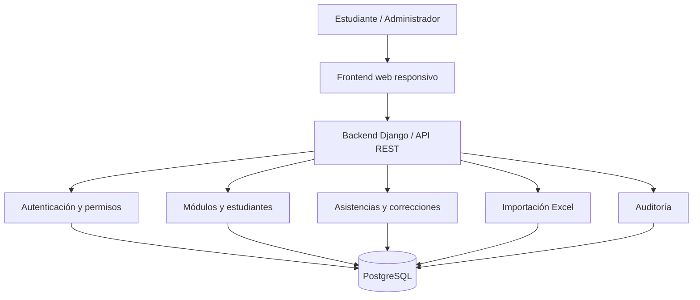
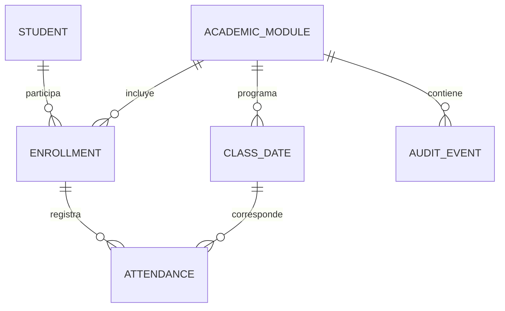

# Especificación funcional y técnica — Sistema Web de Registro y Control de Asistencia

**Versión:** 1.0 — propuesta de implementación  
**Fuente principal:** `Requerimientos_Control_Asistencia.pdf` (4 páginas, versión inicial).  
**Estado:** documento de análisis y diseño; no implica que el sistema esté implementado.

> **Convenciones:** **[FUENTE]** requisito explícito del PDF; **[PROPUESTA]** decisión de diseño recomendada, modificable; **[PENDIENTE]** definición que debe confirmarse antes o durante el desarrollo. Las recomendaciones no amplían por sí mismas el alcance obligatorio.

## 1. Objetivo, alcance y límites

**[FUENTE]** Aplicación web para que estudiantes de un módulo académico registren y consulten asistencias. El administrador importa estudiantes y fechas/horarios mediante Excel, consulta y corrige asistencias, revisa actividades y activa sucesivos módulos. **Solo existe un módulo activo a la vez**. Los datos de módulos anteriores se conservan, pero no se consultan desde la interfaz de esta versión.

### Incluido en el MVP

- Acceso de estudiante por correo o número de registro y acceso separado de administrador.
- Marcación única por estudiante y fecha programada, durante todo el día de clase.
- Historial personal y resumen de presentes/faltas.
- Panel administrativo: estudiantes, búsqueda, asistencia global, filtros, correcciones y auditoría.
- Importación Excel de estudiantes y calendario; activación confirmada de módulo nuevo.
- Persistencia de datos y conservación de módulos anteriores.

### Fuera de alcance [FUENTE]

- Consulta/recuperación de módulos académicos anteriores desde la aplicación.
- Más de un módulo activo simultáneamente.
- Notificaciones, QR, geolocalización y reconocimiento facial.
- Cálculo de atrasos, tolerancias o control de ingreso por horario: las horas de inicio/fin son **informativas**.

### Funcionalidades opcionales [FUENTE]

- **RF-16:** vista previa de estudiantes y fechas antes de activar módulo.
- **RF-17:** exportar a Excel las asistencias del módulo activo.
- **RF-18:** mensajes de confirmación/error al marcar, importar o modificar.

## 2. Actores y permisos

| Acción                                 | Estudiante               | Administrador          |
| -------------------------------------- | ------------------------ | ---------------------- |
| Ingresar al sistema                    | Identificador propio     | Credenciales propias   |
| Marcar asistencia de hoy               | Sí, si es fecha de clase | No exigido             |
| Ver historial personal                 | Sí                       | Mediante vista general |
| Consultar lista y asistencias globales | No                       | Sí                     |
| Corregir asistencias, incluso pasadas  | No                       | Sí                     |
| Importar estudiantes y fechas          | No                       | Sí                     |
| Activar nuevo módulo                   | No                       | Sí, con confirmación   |
| Ver auditoría general                  | No                       | Sí                     |

**[PENDIENTE — seguridad]** El PDF permite acceso estudiantil usando solo correo **o** número de registro. Esos datos pueden ser conocidos por terceros: **no constituyen autenticación robusta**. Para un sistema real se recomienda verificación adicional (contraseña, código temporal u otro mecanismo), previa aprobación porque altera la experiencia prevista. Como mínimo, limitar intentos y evitar exposición de información por enumeración.

## 3. Requerimientos funcionales trazables

| Código | Requisito [FUENTE]                                                                         | Criterio de aceptación verificable                                                |
| ------ | ------------------------------------------------------------------------------------------ | --------------------------------------------------------------------------------- |
| RF-01  | Ingreso de estudiante por correo o registro; debe pertenecer al módulo activo              | Identificador válido del módulo activo accede; inexistente/inactivo recibe error  |
| RF-02  | Administrador con credenciales, autorización y cierre de sesión                            | Usuario no administrador no accede a rutas administrativas; sesión puede cerrarse |
| RF-03  | Marcar una vez en fecha programada y guardar fecha/hora reales                             | Hoy programado permite una marca; segunda marca rechazada; otros días no          |
| RF-04  | Falta al terminar fecha sin marca; solo admin corrige pasado                               | Clase pasada sin marca aparece como Falta; estudiante no modifica pasado          |
| RF-05  | Historial personal de fechas, estados, hora y totales                                      | Solo datos del estudiante y módulo activo; presentes muestran hora                |
| RF-06  | Listar estudiantes con registro, nombre, correo y búsqueda                                 | Admin filtra por nombre o número de registro                                      |
| RF-07  | Admin cambia Presente/Falta en fechas programadas; auditar cambios                         | Cambio persistido con actor, fecha/hora, estado anterior y nuevo                  |
| RF-08  | Vista general, filtros por fecha/estudiante y totales                                      | Totales coherentes con filtros y estado de fechas                                 |
| RF-09  | Actividades importantes con usuario, acción, fecha/hora, registro afectado                 | Marcas y modificaciones administrativas generan eventos                           |
| RF-10  | Historial de actividades del módulo activo, filtros estudiante/fecha                       | Admin consulta; estudiante no accede al historial general                         |
| RF-11  | Importar Excel estudiantes con registro, nombre, correo; validar obligatorios y duplicados | Archivo inválido informa filas/errores; datos válidos se importan                 |
| RF-12  | Importar Excel fechas, hora inicio/fin; marcar todo el día programado                      | Horarios se almacenan, pero no restringen botón por hora                          |
| RF-13  | Activar nuevo módulo con confirmación y sin asistencias iniciales                          | Cambio confirmado activa nuevo y desactiva anterior sin borrar datos              |
| RF-14  | Persistir estudiantes, módulos, fechas, asistencias y actividades                          | Reiniciar aplicación no pierde registros                                          |
| RF-15  | Conservar registros de módulos anteriores y asociarlos a su módulo                         | Datos históricos siguen en BD y no aparecen en vistas del activo                  |

## 4. Reglas de negocio y decisiones de interpretación

| Regla [FUENTE] | Aplicación                                                |
| -------------- | --------------------------------------------------------- |
| RN-01          | Un solo módulo activo                                     |
| RN-02          | Registro de estudiante único **dentro del módulo activo** |
| RN-03          | Una marca por estudiante y fecha de clase                 |
| RN-04          | Estudiante solo marca el día programado                   |
| RN-05          | Al finalizar el día, ausencia de marca = Falta            |
| RN-06          | Solo administrador modifica asistencias fuera de fecha    |
| RN-07          | Toda modificación administrativa se audita                |
| RN-08          | Reinicio conserva historia                                |

**[PROPUESTA] Interpretación de estados:** una fecha futura debe mostrar **Pendiente** o **No evaluada**, no Falta, para no contar ausencias anticipadas. En el día actual, sin marca, también puede mostrarse **Pendiente** hasta que termine el día; al terminar, pasa a **Falta**. El PDF menciona Presente/Falta en historial, pero no especifica la representación de fechas futuras y del día en curso. Confirmar este detalle de interfaz.

**[PROPUESTA]** No crear una fila física de Falta para cada ausencia: calcularla a partir de la falta de marca en una clase finalizada, excepto cuando el administrador registra una corrección explícita. Esto reduce procesos programados y evita faltas prematuras. El registro de correcciones explícitas debe tener precedencia sobre el cálculo derivado.

## 5. Arquitectura de software propuesta

**[PROPUESTA] Arquitectura monolítica modular, cliente-servidor, API REST**, suficiente para este alcance. No se necesitan microservicios, colas ni arquitectura distribuida en el MVP.

**Stack sugerido (no prescrito por el PDF):**

- **Frontend:** React + TypeScript + Vite; interfaz responsiva. Alternativa más sencilla: plantillas Django renderizadas en servidor.
- **Backend:** Python + Django + Django REST Framework.
- **Base de datos:** PostgreSQL.
- **Importación/exportación Excel:** `openpyxl` con validación en backend.
- **Autenticación administrativa:** sesiones seguras de Django (cookies HttpOnly, Secure en HTTPS y protección CSRF); permisos por rol.
- **Despliegue:** aplicación Django + PostgreSQL + servidor HTTPS/reverse proxy; contenedores Docker opcionales.



### Organización del backend [PROPUESTA]

```text
backend/
  config/              # configuración, rutas, seguridad
  apps/
    accounts/          # administradores, identidad y permisos
    academic_modules/  # módulo activo, calendario, activación
    students/          # inscripción/estudiantes por módulo
    attendance/        # marcas, estados, correcciones, resumen
    imports/           # lectura y validación de Excel
    audit/             # bitácora y filtros
  tests/
frontend/
  src/
    pages/             # acceso, estudiante, administración
    components/        # tablas, filtros, formularios
    services/          # cliente HTTP
    auth/              # control de sesión y rutas
```

**Principio:** toda autorización, validación de fecha y unicidad se verifica en el **servidor**, no solo mediante botones deshabilitados en frontend.

## 6. Modelo de datos relacional propuesto

El PDF exige persistir módulos, estudiantes, fechas, asistencias y actividades, pero **no define tablas ni tipos de columnas**. Este es un modelo sugerido:

| Tabla             | Campos principales                                                                                                 | Restricciones/relaciones                                                |
| ----------------- | ------------------------------------------------------------------------------------------------------------------ | ----------------------------------------------------------------------- |
| `academic_module` | `id`, `name`, `is_active`, `created_at`, `activated_at`, `closed_at`                                               | Un único módulo activo global                                           |
| `student`         | `id`, `registration_number`, `full_name`, `email`, `created_at`                                                    | Identidad base; no asumir unicidad global de registro                   |
| `enrollment`      | `id`, `module_id`, `student_id`, `registration_number`, `email`                                                    | Único `(module_id, registration_number)`; relaciona estudiante y módulo |
| `class_date`      | `id`, `module_id`, `class_date`, `start_time`, `end_time`                                                          | Único `(module_id, class_date)` para modelo de una clase por día        |
| `attendance`      | `id`, `enrollment_id`, `class_date_id`, `status`, `marked_at`, `created_by_admin`, `updated_at`                    | Único `(enrollment_id, class_date_id)`; validar mismo módulo            |
| `audit_event`     | `id`, `module_id`, `actor_type`, `actor_id`, `action`, `entity_type`, `entity_id`, `before`, `after`, `created_at` | Eventos inmutables; valores previos/nuevos en JSON cuando aplique       |
| `admin_user`      | Usuario Django o referencia a él                                                                                   | Credenciales seguras y permisos administrativos                         |

**[PROPUESTA]** `attendance.status` puede ser `PRESENT` o `ABSENT` para representar una corrección administrativa explícita. La ausencia calculada no requiere fila. `marked_at` debe reflejar la hora real de marcación; si el administrador corrige una falta a presente sin marca original, guardar por separado la hora de corrección y mostrar “corregida por administrador”, sin inventar una hora de entrada.

**[PENDIENTE]** Si un estudiante puede participar en varios módulos, conviene mantener `student` + `enrollment`. Definir si la identidad se reconoce globalmente o si se crean estudiantes independientes por módulo; ambos enfoques preservan unicidad **por módulo**. Para evitar conflictos, definir también si el correo puede repetirse dentro de un módulo y cómo se desambigua el acceso.

**[PROPUESTA] Integridad:** claves foráneas, índices en fecha/módulo/registro, transacciones para cambios críticos, restricción parcial de módulo activo en PostgreSQL (`UNIQUE` condicional para `is_active = TRUE`), validación de que inscripción y clase pertenezcan al mismo módulo, y restricciones únicas que prevengan doble marcación incluso ante solicitudes simultáneas.



## 7. Contrato API sugerido (no exigido por la fuente)

Prefijo `/api/v1`. Endpoints y verbos son propuestas; los nombres definitivos pueden variar.

| Método | Endpoint                           | Rol         | Operación                                                       |
| ------ | ---------------------------------- | ----------- | --------------------------------------------------------------- |
| POST   | `/auth/student-login`              | Público     | Validar identificador del módulo activo y crear sesión limitada |
| POST   | `/auth/admin-login`                | Público     | Iniciar sesión administrativa                                   |
| POST   | `/auth/logout`                     | Autenticado | Cerrar sesión                                                   |
| GET    | `/me`                              | Autenticado | Identidad, rol y módulo activo                                  |
| GET    | `/student/attendance`              | Estudiante  | Historial y resumen propios                                     |
| POST   | `/student/attendance`              | Estudiante  | Marcar clase de hoy, idempotencia controlada                    |
| GET    | `/admin/students`                  | Admin       | Listar/buscar estudiantes activos                               |
| GET    | `/admin/attendance`                | Admin       | Matriz/lista, filtros y totales                                 |
| PATCH  | `/admin/attendance/{id}`           | Admin       | Corregir registro existente                                     |
| PUT    | `/admin/attendance/correction`     | Admin       | Crear o actualizar corrección para una fecha sin fila previa    |
| GET    | `/admin/audit-events`              | Admin       | Consultar bitácora filtrada                                     |
| POST   | `/admin/imports/students/validate` | Admin       | Validar Excel estudiantes                                       |
| POST   | `/admin/imports/dates/validate`    | Admin       | Validar Excel fechas                                            |
| POST   | `/admin/modules/activate`          | Admin       | Activación confirmada y transaccional                           |
| GET    | `/admin/attendance/export`         | Admin       | Exportación opcional RF-17                                      |

**[PROPUESTA]** Respuestas JSON consistentes, por ejemplo `{"code":"ATTENDANCE_ALREADY_MARKED","message":"La asistencia ya fue registrada"}`. Códigos HTTP: 400 archivo/formato inválido; 401 sin autenticación; 403 sin permiso; 404 recurso no visible; 409 duplicidad/conflicto; 422 reglas de validación.

## 8. Flujos principales

### 8.1 Ingreso y marcación del estudiante

1. Estudiante introduce correo **o** número de registro.
2. Backend verifica pertenencia al módulo activo y establece identidad de sesión (seguridad pendiente de definir).
3. Backend determina la fecha actual según **zona horaria institucional configurada**.
4. Si hoy es fecha programada y no existe marca, permite registrar.
5. Al confirmar, servidor valida de nuevo fecha, identidad, módulo y unicidad; guarda hora real y evento de auditoría en una transacción.
6. Devuelve confirmación y actualiza historial. Si no hay clase hoy, o ya marcó, impide nueva marca.

### 8.2 Cálculo de estado e historial

1. Obtener fechas del módulo activo y la marca/corrección del estudiante.
2. Corrección explícita `PRESENT` o `ABSENT` tiene prioridad.
3. Si hay marca válida: **Presente**, con hora original.
4. Si la fecha ya terminó y no hay marca: **Falta**.
5. Si la fecha no ha terminado y no hay marca: **Pendiente** [PROPUESTA].
6. Totales de presentes/faltas consideran únicamente fechas ya evaluables; confirmar si el día actual con marca cuenta como presente inmediatamente (recomendado: sí).

### 8.3 Corrección administrativa

1. Administrador filtra estudiante y fecha programada.
2. Solicita cambiar a Presente o Falta.
3. Backend comprueba permisos y que inscripción/fecha sean del módulo activo.
4. En una transacción, guarda cambio y evento de auditoría con anterior/nuevo estado, actor y fecha/hora.
5. La auditoría no debe poder editarse ni eliminarse desde la interfaz.

### 8.4 Importación y activación del nuevo módulo

1. Administrador carga Excel de estudiantes y Excel de fechas.
2. Backend valida estructura, tipos, campos obligatorios, duplicados y coherencia.
3. Mostrar errores por archivo, fila, columna y descripción; **no activar** si existen errores bloqueantes.
4. **[PROPUESTA]** Preparar datos en un borrador temporal y presentar resumen antes de confirmar (RF-16 opcional).
5. Solicitar confirmación explícita de activación.
6. En una sola transacción, cerrar módulo anterior, crear/activar el nuevo con sus estudiantes y fechas, e iniciar con cero asistencias.
7. Mantener intactos los datos anteriores y registrar actividad administrativa de activación [PROPUESTA].
8. Invalidar o revalidar sesiones estudiantiles del módulo anterior [PROPUESTA].

## 9. Importación Excel: contratos y validaciones

### Archivo 1: estudiantes [FUENTE]

| Número de registro | Nombre completo | Correo electrónico |
| ------------------ | --------------- | ------------------ |
| 1001               | Juan Pérez      | juan@gmail.com     |
| 1002               | María López     | maria@gmail.com    |

### Archivo 2: fechas de clases [FUENTE]

| Fecha      | Hora inicio | Hora fin |
| ---------- | ----------- | -------- |
| 05/10/2026 | 18:00       | 21:00    |
| 07/10/2026 | 18:00       | 21:00    |

**Obligatorias según fuente:** validar campos requeridos y números de registro duplicados; reportar errores. Fechas y horas determinan calendario, pero **no** limitan por horario el registro de asistencia.

**[PROPUESTA] Validaciones adicionales:**

- Aceptar `.xlsx` y fijar límite de tamaño/filas configurable; rechazar archivos corruptos y formatos no admitidos.
- Leer número de registro como texto para preservar ceros iniciales.
- Quitar espacios externos; validar correo con formato básico; no modificar silenciosamente datos.
- Comprobar fechas reales, horas válidas, `inicio < fin`, fechas duplicadas y celdas vacías.
- Detectar duplicados dentro del Excel, incluyendo normalización definida del registro.
- Rechazar hojas con encabezados incompatibles; reportar `archivo`, `fila`, `campo`, `error`.
- No realizar activación parcial ante errores; validar y confirmar antes de escribir el módulo activo.
- No ejecutar fórmulas ni macros; procesar Excel como datos no confiables.

**[PENDIENTE]** Precisar nombres exactos de hojas/encabezados, zona horaria, si fechas pasadas se admiten al importar, si se admiten clases repetidas en un mismo día y si se permiten estudiantes sin correo (el PDF lo presenta como campo del Excel y exige campos obligatorios).

## 10. Pantallas y experiencia de usuario

| Pantalla             | Contenido mínimo                                                     |
| -------------------- | -------------------------------------------------------------------- |
| Acceso estudiante    | Campo correo/registro, error de no pertenencia, entrada              |
| Inicio estudiante    | Módulo activo, fecha actual, botón Marcar asistencia y estado de hoy |
| Historial estudiante | Fechas, Presente/Falta, hora de marca cuando exista, totales         |
| Acceso administrador | Usuario/contraseña y cerrar sesión                                   |
| Panel administrador  | Resumen de presentes/faltas, navegación                              |
| Estudiantes          | Tabla registro/nombre/correo, búsqueda                               |
| Asistencias          | Tabla/matriz por estudiante/fecha, filtros, totales y corrección     |
| Actividades          | Usuario, acción, fecha/hora, registro afectado, filtros              |
| Importación y módulo | Carga de dos Excel, errores, confirmación y activación               |

**[PROPUESTA]** Diseño móvil primero para estudiantes; tablas paginadas para administración, estados legibles, formularios accesibles, mensajes claros y protección frente a doble clic.

## 11. Requisitos no funcionales recomendados

El PDF **no establece métricas** de rendimiento, concurrencia, disponibilidad ni retención. Los siguientes son objetivos sugeridos, no requisitos aprobados:

- **Seguridad:** HTTPS, contraseñas de administradores con hash robusto de Django, cookies seguras, CSRF/CORS bien configurados, validación de permisos por endpoint, rate limiting, protección contra inyección y XSS.
- **Privacidad:** acceso solo a datos propios del estudiante, mínima exposición de correos, manejo restringido de Excel, no registrar contraseñas ni identificadores sensibles innecesarios en logs.
- **Integridad:** transacciones atómicas, restricciones de BD, timestamps de servidor, no sobrescribir auditorías.
- **Rendimiento [objetivo inicial]:** consultas comunes p95 < 2 s en condiciones de carga definidas durante pruebas; paginación para listados.
- **Disponibilidad [PENDIENTE]:** definir horario de uso, mantenimiento y recuperación aceptable.
- **Respaldo:** copias de seguridad periódicas y prueba de restauración, con frecuencia/retención a acordar.
- **Observabilidad:** logs estructurados de errores, métricas básicas, monitoreo de salud de aplicación y BD.
- **Mantenibilidad:** migraciones, variables de entorno, pruebas automatizadas y documentación de instalación.
- **Zona horaria:** almacenar instantes en UTC y evaluar día de clase en la zona horaria académica configurada.

## 12. Casos límite y riesgos a resolver

1. **Acceso por identificador conocido:** posible suplantación; decidir mecanismo de verificación adicional antes de producción.
2. **Marcación simultánea:** dos clics o pestañas; la restricción única en BD debe impedir duplicados.
3. **Cambio de módulo durante una sesión:** verificar módulo activo en cada acción; no aceptar sesiones del módulo anterior.
4. **Cambio de día a medianoche:** usar fecha del servidor en zona horaria institucional; no confiar en reloj del navegador.
5. **Fecha futura:** no contar como Falta antes de que termine el día.
6. **Corrección Falta → Presente:** no inventar hora de marcación; distinguir marca real y corrección.
7. **Corrección Presente → Falta:** conservar la marca original/auditoría según política acordada, sin perder trazabilidad.
8. **Excel duplicado o malformado:** rechazo controlado y reporte por fila.
9. **Activación fallida:** rollback integral; el módulo anterior debe permanecer activo si la operación no termina.
10. **Correcciones del mismo valor:** decidir si registrar evento de intento o tratar como operación sin cambio.
11. **Más de una clase por fecha:** PDF habla de una marca por fecha; modelo propuesto supone una sola clase por día dentro del módulo.
12. **Correos duplicados:** si el login admite correo, definir qué hacer si identifica a más de un estudiante.
13. **Módulo sin clases o sin estudiantes:** definir si se permite activarlo (recomendación: no).
14. **Auditoría histórica:** datos antiguos se conservan, pero no deben exponerse mediante endpoints del módulo activo.

## 13. Estrategia de pruebas y criterios de cierre

### Pruebas unitarias

- Validación de fecha programada y día académico; estado derivado Presente/Falta/Pendiente.
- Detección de duplicados de registro y fecha en Excel.
- Resumen de asistencia y precedencia de corrección explícita.
- Permisos por rol y pertenencia al módulo.

### Pruebas de integración

- Marcar dos veces (incluida concurrencia): solo una marca persistida.
- Marcar fuera de fecha: rechazo del servidor.
- Corrección de fecha pasada: cambia estado y crea auditoría con antes/después.
- Activación: antiguo módulo desactivado, datos conservados, nuevo sin marcas.
- Excel inválido: no deja activación parcial.
- Reinicio de aplicación: datos persisten.
- Usuario estudiante: no accede a vistas administrativas ni datos de terceros.

### Pruebas de aceptación basadas en RF

- **RF-01–02:** accesos y restricciones comprobados.
- **RF-03–05:** marcación, faltas e historial correctos.
- **RF-06–10:** listados, filtros, correcciones y bitácora operativos.
- **RF-11–13:** importaciones validadas y activación confirmada sin pérdida histórica.
- **RF-14–15:** persistencia y aislamiento de módulos verificados.
- **RF-16–18:** evaluar únicamente si se incluyen en el alcance contratado.

**Definición de terminado [PROPUESTA]:** criterios de aceptación aprobados, migraciones aplicadas, pruebas automatizadas esenciales verdes, despliegue HTTPS probado, respaldo/restauración verificados y guía de operación entregada.

## 14. Plan de implementación por etapas

| Etapa               | Trabajo                                                                 | Entregable                    |
| ------------------- | ----------------------------------------------------------------------- | ----------------------------- |
| 0. Aclaraciones     | Resolver decisiones pendientes, seguridad de acceso y reglas de estados | Reglas aprobadas              |
| 1. Base técnica     | Proyecto, configuración, BD, migraciones, roles y sesiones              | Aplicación inicial segura     |
| 2. Modelo académico | Módulos, estudiantes, inscripciones y calendario                        | Datos y restricciones         |
| 3. Asistencia       | Marcación, estado derivado, historial, totales                          | Flujo estudiante              |
| 4. Administración   | Listados, filtros, correcciones y auditoría                             | Panel administrativo          |
| 5. Importación      | Lectura/validación Excel, activación transaccional                      | Ciclo de módulos              |
| 6. Calidad          | Pruebas, seguridad, errores, rendimiento, respaldo                      | MVP verificable               |
| 7. Opcionales       | Vista previa, exportación y mensajes enriquecidos                       | RF-16 a RF-18, si se aprueban |

**Orden recomendado:** definir identidad/seguridad y estado de asistencia **antes** de implementar endpoints y modelo final.

## 15. Preguntas pendientes para aprobación

1. ¿El acceso estudiantil será exclusivamente por correo/registro como en el PDF o se añadirá verificación para evitar suplantación?
2. ¿Qué zona horaria oficial debe usarse para determinar el día de clase?
3. ¿Cómo se visualizan fechas futuras y el día actual sin marca: Pendiente u otra etiqueta?
4. ¿Se permite más de una clase en el mismo día? El PDF presupone una marca por estudiante y fecha.
5. ¿Los estudiantes se reutilizan entre módulos o se crean registros independientes?
6. ¿Puede repetirse el correo en un módulo? ¿Cómo se resolvería el acceso ambiguo?
7. ¿Qué nombre recibe el módulo y cómo se asigna (manual, automático, desde Excel)?
8. ¿Qué se hace si un administrador marca Presente sin hora de entrada original?
9. ¿Qué volumen máximo de estudiantes, fechas y usuarios simultáneos se espera?
10. ¿Dónde se alojará la aplicación y cuál es la política de respaldo/retención?
11. ¿La vista previa de importación y exportación a Excel serán parte del MVP o posteriores?
12. ¿Se requiere registrar un motivo de corrección? No lo exige el PDF, pero ayuda a auditoría.

## 16. Matriz de correspondencia con el documento fuente

- **Página 1:** objetivo, conservación de datos, roles, RF-01 a RF-03.
- **Página 2:** RF-04 a RF-11.
- **Página 3:** RF-12 a RF-15, RN-01 a RN-08 y comienzo de formatos Excel.
- **Página 4:** ejemplos de Excel, RF-16 a RF-18 y exclusiones.

**Nota final:** los requisitos **[FUENTE]** son el alcance de referencia. Arquitectura, stack, esquema SQL, API, estados `Pendiente`, objetivos no funcionales y controles adicionales están etiquetados como **[PROPUESTA]**; las ambigüedades requieren confirmación **[PENDIENTE]** antes de convertirlas en reglas definitivas.
